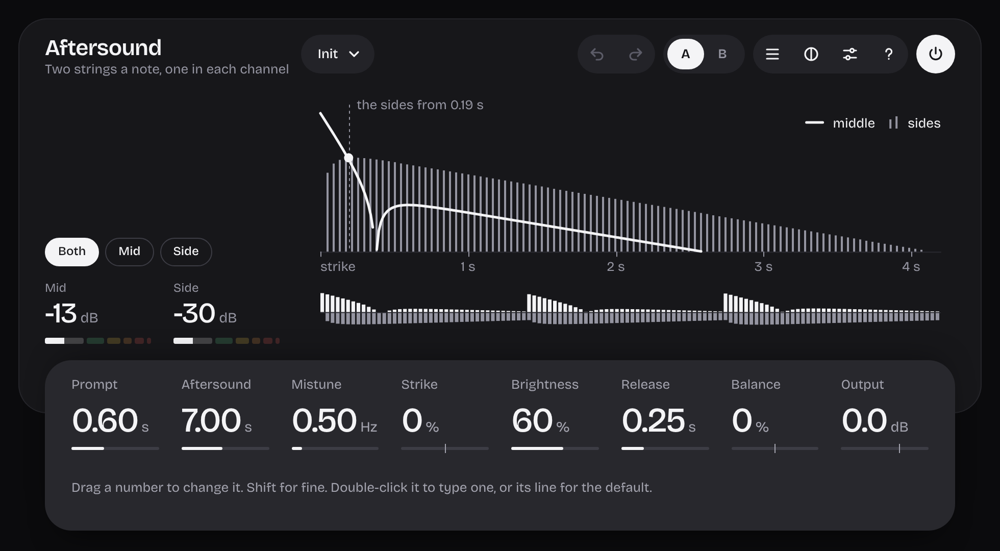

# Aftersound

An instrument in which every note is two coupled strings, one in each
channel. What the strings do together dies fast into the bridge and is
heard in the middle; what they do against each other rings on and is
heard in the sides. Each note starts narrow and blooms wide as it
dies, by the law that gives a piano its double decay.

- `NOVELTY.md`: what is new about it, and what was found looking for
  it elsewhere.
- `benchmark.json`: how it stands against the best of its kind.
- `src/lib.rs`: the spec (who it is, its settings and its meters) and
  the sound: the strings, the bridge and the hammer.
- `ui/main.js`, `ui/style.css`: the editor, built round the two decays.
- `ui/foreseen.js`: the two decays as the page works them out, and
  `ui/test.js`, which holds them to the sound's own numbers.
- `tests/suite.rs`: the checks every plugin is held to.
- `tests/sound.rs`: what this plugin itself promises.
- `docs/manual.md`, `docs/scenes.json`, `docs/images/`: the manual and
  the scenes its pictures are taken from.
- `examples/demo.rs`: renders WAV demos to listen to, each a phrase on
  strings tuned alike and then the same phrase with the aftersound.
- `examples/spec.rs`: the spec as JSON, for the docs tools.
