# Aftersound

Aftersound is an instrument in which every note is two strings, one
heard in the left channel and one in the right, joined at a shared
bridge as the strings of a piano's note are. Struck together, the two
strings move as one, and the bridge takes that motion away quickly:
that is the bright, short prompt sound, and since the two channels are
the same it sits in the middle. Tuned a hair apart, the strings drift
out of step, and the part of their motion where they swing against
each other hardly moves the bridge at all, so it rings on for a long
time: that is the aftersound, and since the two channels are then
opposite it is heard in the sides.

So each note starts narrow and blooms wide as it dies. This is the
same law that gives a piano note its two decays; Aftersound lets you
hear the two strings themselves, one in each ear, so the two decays
become two places.

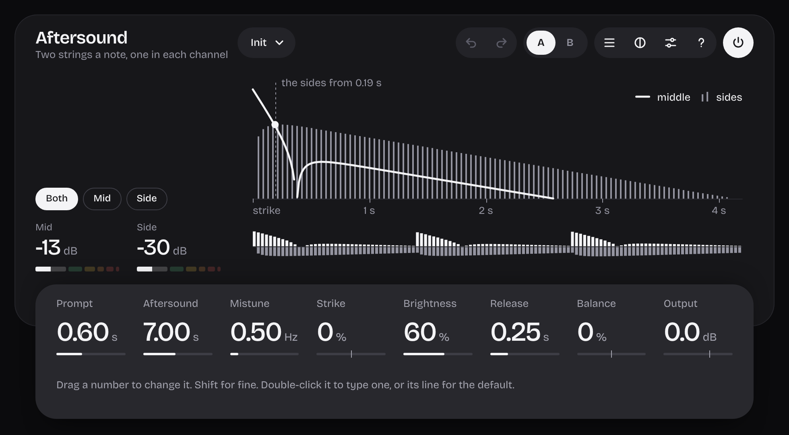

## Getting started

Put Aftersound on an instrument track and play. Slow notes and held
chords show it best: listen to how each note settles out of the middle
into the space around it. Then:

- Turn **Mistune** up to make the sides take over sooner and, past a
  point, beat against the middle; down for a note that stays in the
  middle longer.
- Turn **Prompt** down for a sharper, shorter attack in the middle;
  up for a fuller one.
- Set **Aftersound** for how long the wide tail rings.

Aftersound needs to be heard in stereo. In mono you hear only the
middle: the prompt sound and a little of the tail.

### The picture

The dark glass shows a note's two decays as the settings make them,
for a note at A below middle C, struck at the left edge. Up is louder,
in decibels, down to 60 dB below the strike.

- The **line** is the middle. It falls fast at first, while the bridge
  takes what the two strings do together.
- The **columns** are the sides. They rise out of nothing as the
  strings drift apart, then ring on, falling slowly.
- The **dashed line** and the dot mark where the sides first become
  louder than the middle, with the time written above it.

With a large Mistune the two strings beat: the line and the columns
swap places again and again, and both die sooner.

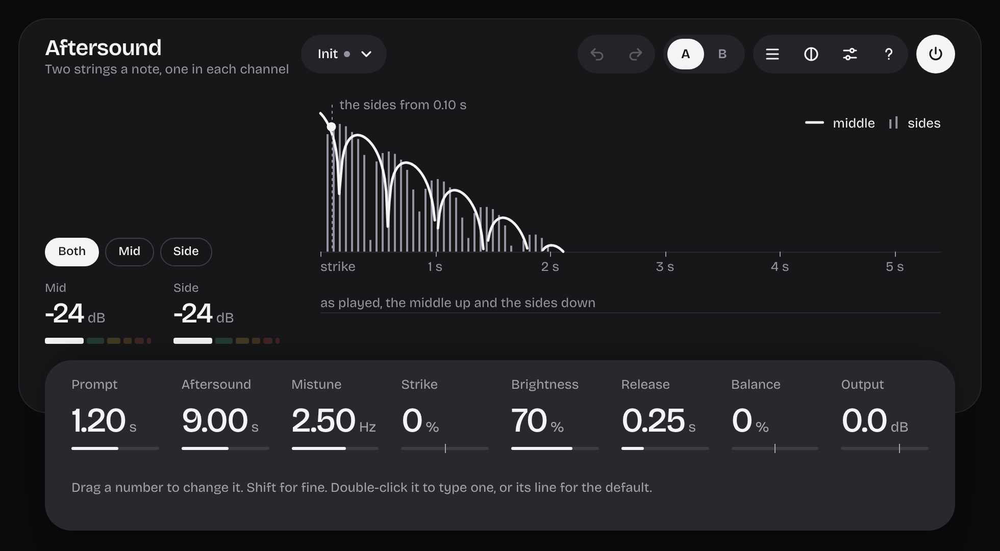

The curves are worked out by the same law the strings follow, at the
note's fundamental. The upper partials of a real note are tuned apart
by as many times the Mistune as their number, so they spread into the
sides sooner than the picture shows: the shimmer of the strike is wide
before the body of the note is.

Along the foot of the glass, the last four seconds of what you played:
each column above the line is the middle's level at that moment, each
below it the sides'. Each strike is a tall column up, and the sides'
columns below show the aftersound gathering.

**Mid** and **Side**, at the left of the glass, are the peak levels of
the middle and the sides: each number is the peak, and the segments
under it break at -24, -12, -6, -3 and 0 dB. The last segment lights if
the level clips, and stays lit until you click it.

The glass is also a control: drag it across for more or less Mistune,
and up or down for a longer or shorter Prompt. Double-click it to put
both back.

### Setting things

The numbers are the controls. Drag a number, or the line under it,
left and right. While you hold it, it turns purple, the ends of its
range and a mark at its default appear, and the curve it shapes on the
glass turns purple with it: the line for Prompt, the columns for
Aftersound, Mistune and Strike.

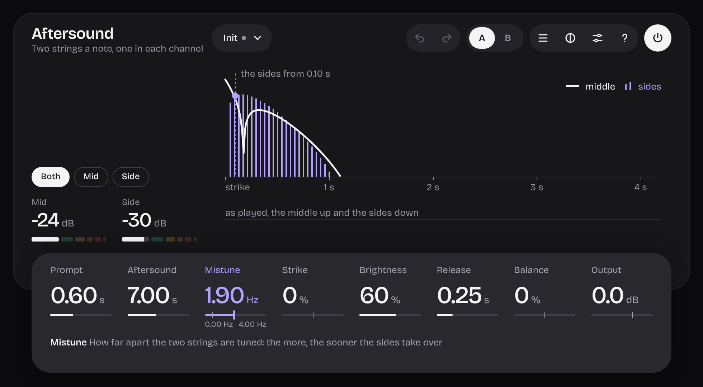

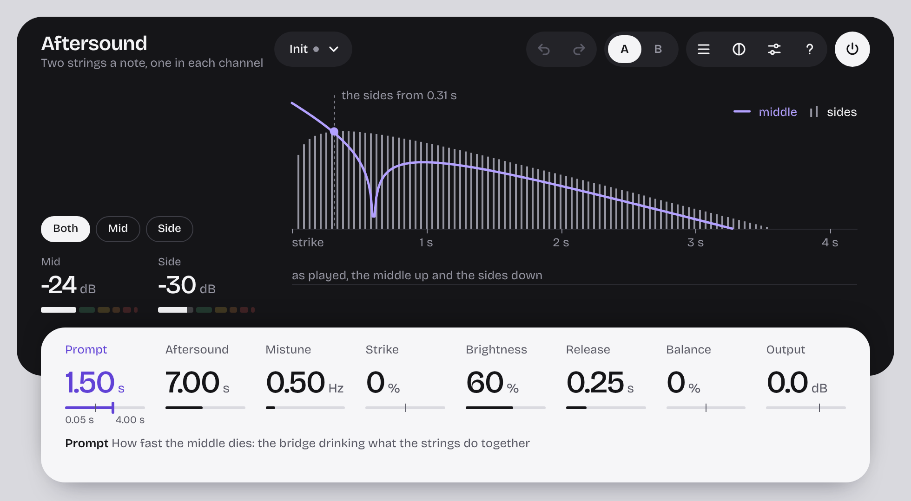

Hold Shift for fine moves, use the mouse wheel or the arrow keys for
single steps, and double-click a line to put it back to its default.
Double-click a number to type one. **Strike**, **Balance** and
**Output** rest in the middle of their ranges, so their lines fill
from their defaults, not from the left.

The foot of the sheet says what the control under the pointer does.

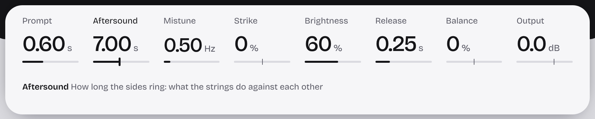

Right-click a number for its menu: type a value, return to the
default, copy, paste, or lock it so a preset leaves it alone. With a
number selected you can also just start typing digits, and Delete puts
it back to its default.

At the far right of the top row is **On**. Press it to silence
Aftersound: it fades out in a hundredth of a second, so it does not
click, and it is the same bypass your host's own button works.

### Comparing and undoing

Undo and redo are the arrows in the top row (or Ctrl+Z and
Ctrl+Shift+Z). **A** and **B** hold two settings of the whole plugin:
make a change, press the other letter to hear where you were, and press
back. Both are forgotten when the editor is closed; the settings
themselves are saved with your project.

### Presets

The menu at the top left of the glass holds Aftersound's own presets
and your own. Pointing at one plays it until you move away; clicking
it loads it, as one step you can undo.

- **Grand unison**: the defaults, a piano's pair of strings.
- **Wide and slow**: a short prompt and a long aftersound, for pads of
  struck notes that open out slowly.
- **Beating pair**: strings far apart, so the note beats between the
  middle and the sides as it dies.
- **Felt, off centre**: a soft hammer that hits one string harder, so
  the sides are there from the first moment.

### Size, density and theme

The editor fills its window at any size and shape. The density button
in the top row trades the size of the numbers for room on the glass:
Regular, where Aftersound starts, Dense and Roomy.

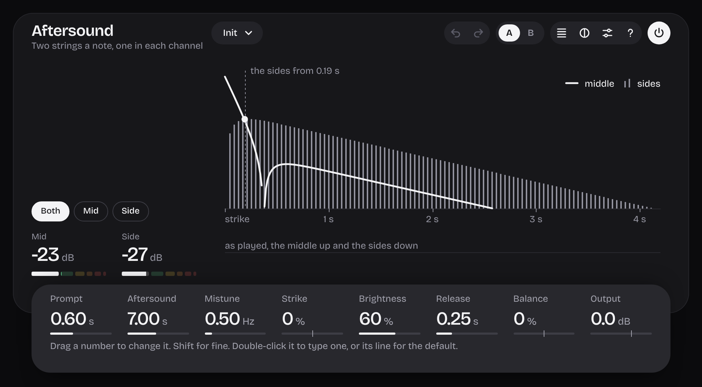

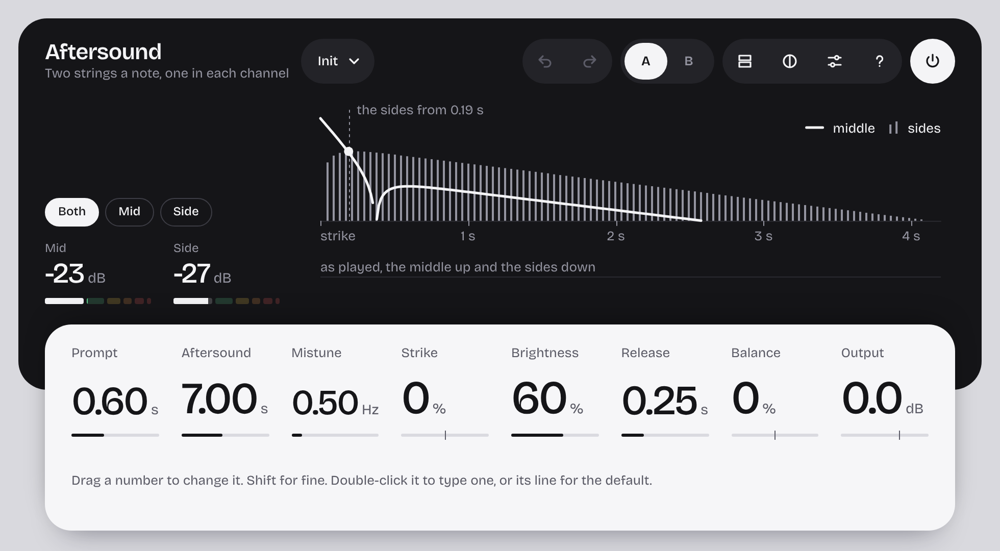

The theme button switches the sheet between light and dark; the glass
is dark in both.

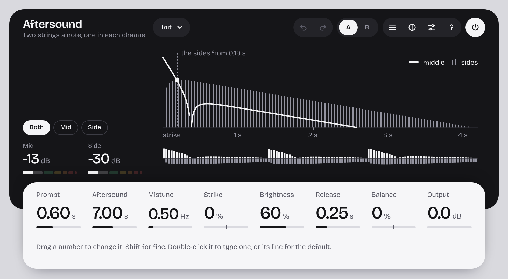

## The settings

### Strings

**Prompt** is how long the middle takes to die away, from 0.05 to 4
seconds (to 60 dB down). It is how hard the bridge pulls on what the
two strings do together. Short is a bright, quick strike; long lets
the middle and sides trade for longer. When Prompt is as long as
Aftersound or longer, the bridge does not pull at all.

**Aftersound** is how long the sides ring, from 0.5 to 30 seconds (to
60 dB down). It is how long the strings themselves ring when the
bridge does not take from them.

**Mistune** is how far apart the two strings are tuned, from 0 to 4 Hz:
one is half of it below the note and the other half of it above. At 0
the strings are the same string and never leave the middle. A little
lets the sides take over and ring; a lot makes the two beat. The
sweetest aftersound is usually between 0.3 and 1 Hz.

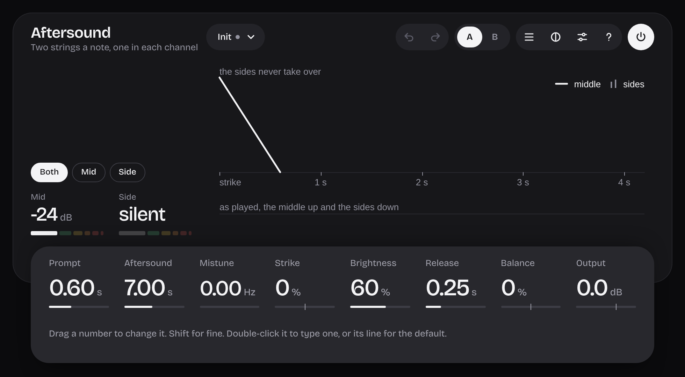

**Release** is how fast the damper stops a note once its key is let
go, from 0.05 to 3 seconds. A sustain pedal (controller 64) holds
notes as a piano's does, where the host passes it on.

### Hammer

**Strike** is which string the hammer hits harder, from -100% (only
the left) to 100% (only the right), resting at 0, even. Off centre,
the strings start out of step, so the sides are there from the first
moment and the note is wide from its start.

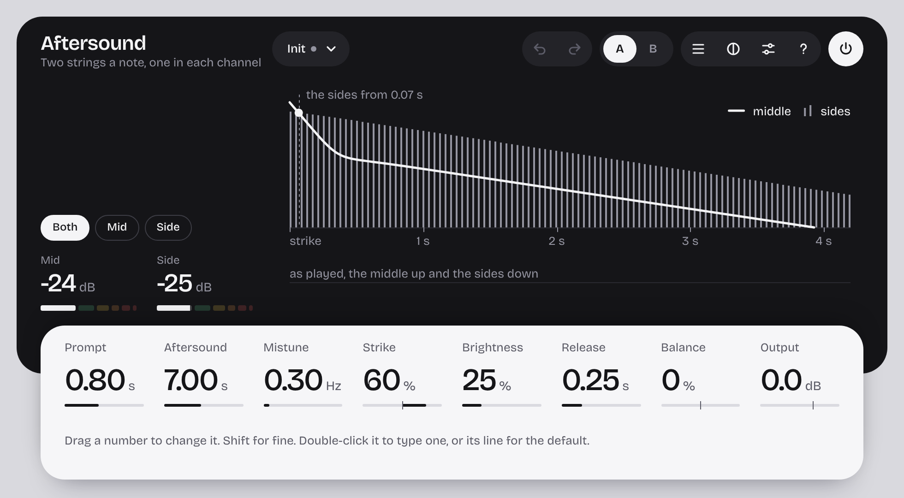

**Brightness** is how hard the hammer is and how long the upper
partials ring, from 0 to 100%. At 0 a partial at 2 kHz dies in about a
tenth of a second, a felt thud; at 100% it rings for six seconds, or as
long as Aftersound if that is shorter. Playing harder is brighter too.

### Mid and side

**Listen** is the three buttons on the glass above the meters.
**Both**, **Mid** and **Side** choose what you hear: everything, the
middle alone (the prompt sound and what of the tail lands there), or
the sides alone (the aftersound).

**Balance** weighs the two halves, from -100 to 100%. Below 0% the
sides are turned down, above it the middle; neither is ever turned up.
Toward the sides is a quick way to bring the aftersound forward.

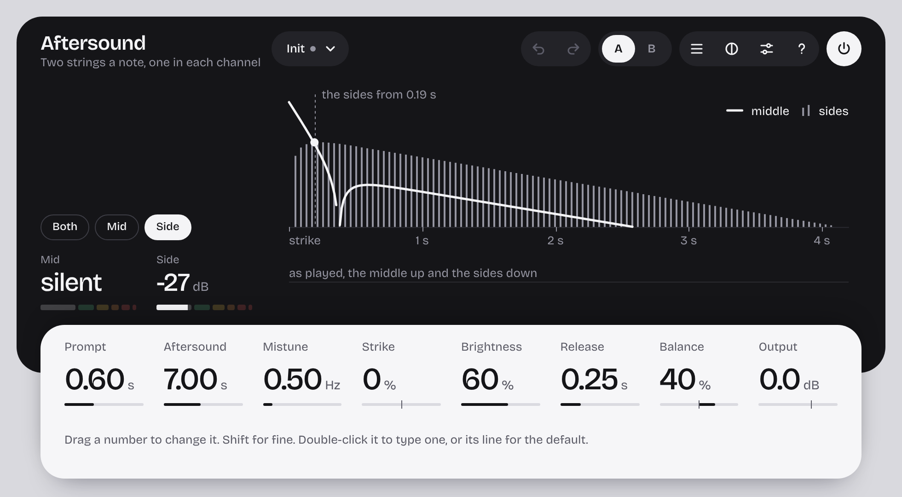

### Output

**Output** sets the level after everything else, from -24 to +12 dB.

**Bypass** silences Aftersound. It is the On button at the right of
the top row, and the one your host's bypass works.

Aftersound has no **Mix** and no **Match**: an instrument has no sound
coming in to blend with or to match its level to.

## Troubleshooting

**It sounds like an ordinary plucked string.** Check that you are
listening in stereo, and that Mistune is above 0 and Prompt is shorter
than Aftersound. Try listening to the sides alone.

**The tail is quiet.** That is how coupled strings behave: the
aftersound is usually 15 to 25 dB under the strike, as on a piano. Move
Balance toward the sides to bring it up.

**Notes beat or wobble.** Mistune is high. Bring it under 1 Hz for a
smooth aftersound.

**High notes are short.** A high string loses its energy faster, as a
piano's does; raise Brightness and Aftersound.

**The sustain pedal does nothing.** Some hosts do not pass controllers
to a VST3 plugin yet. The CLAP version hears it.
