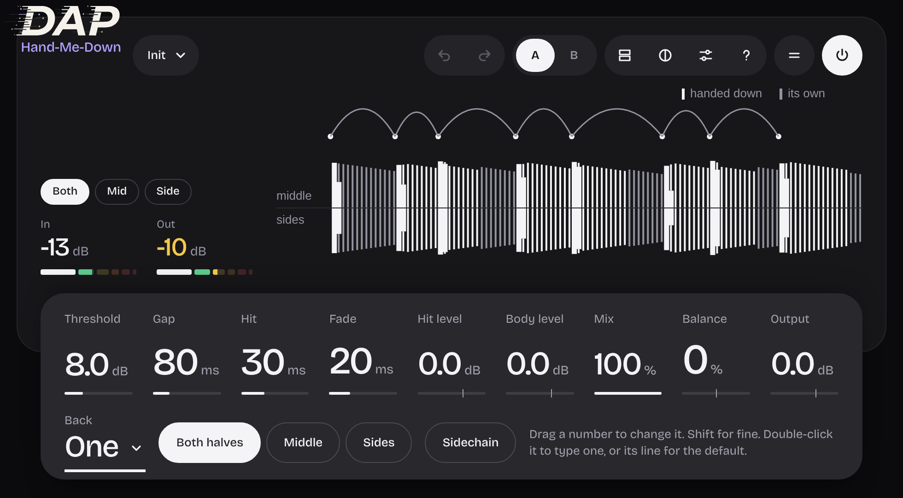

# Hand-Me-Down

Each note keeps its own hit, then plays the body an earlier note left
behind, from the same point in that note's life. On a melodic line the
pluck is now and the ring is one note late; on drums each hit carries
the tail of the drum before it.

- `NOVELTY.md`: what is new about it, and where it was looked for.
- `benchmark.json`: how it stands against the best transient and
  sustain splitters.
- `src/lib.rs`: the spec and the sound.
- `ui/main.js`, `ui/lineage.js`, `ui/style.css`: the editor and the
  family line on its glass.
- `tests/suite.rs`: the checks every plugin is held to.
- `tests/sound.rs`: what this plugin itself promises.
- `ui/test.js`: the page's working out, held to the sound's.
- `docs/manual.md`, `docs/scenes.json`, `docs/images/`: the manual and
  the scenes its pictures are taken from.
- `examples/demo.rs`: renders WAV demos to listen to.
