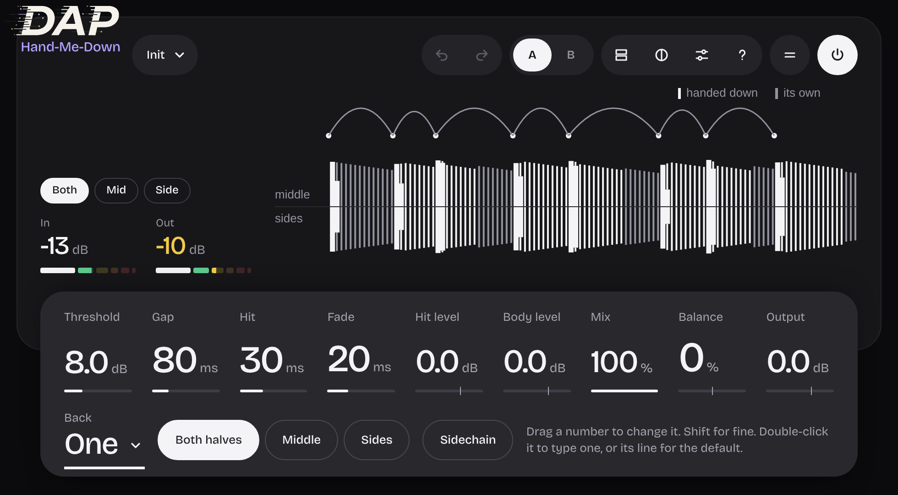
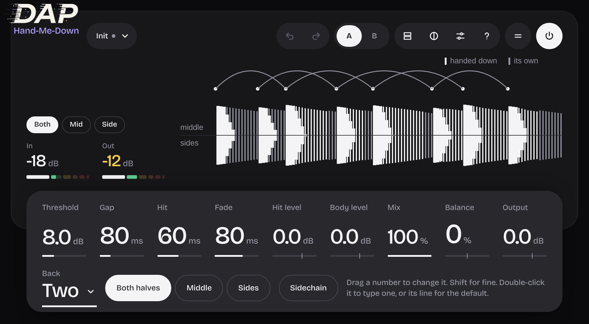
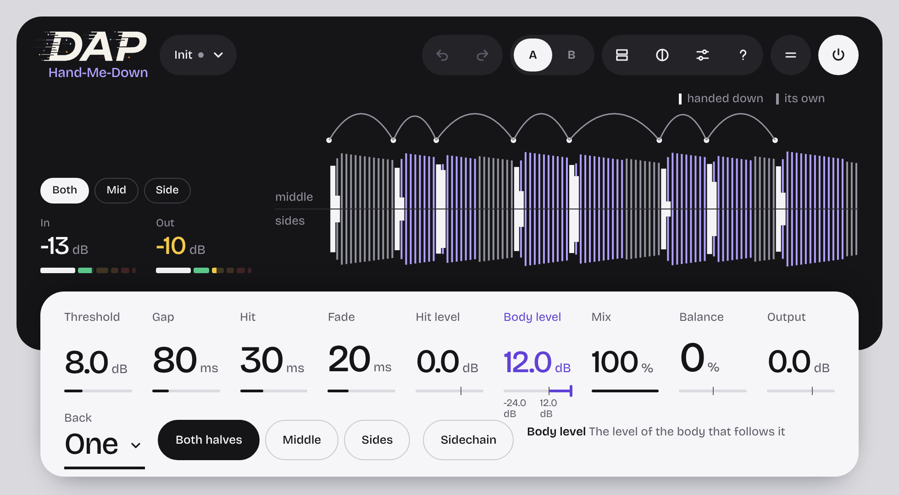
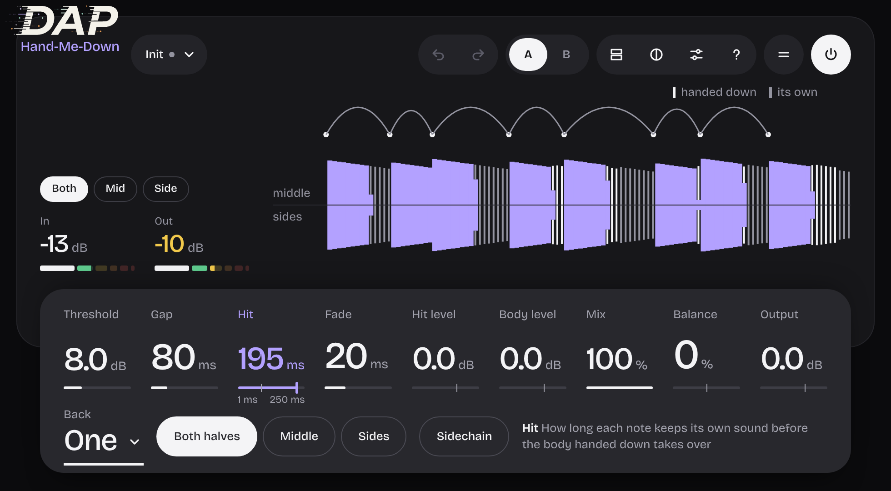
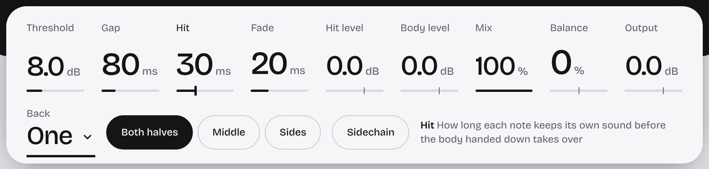
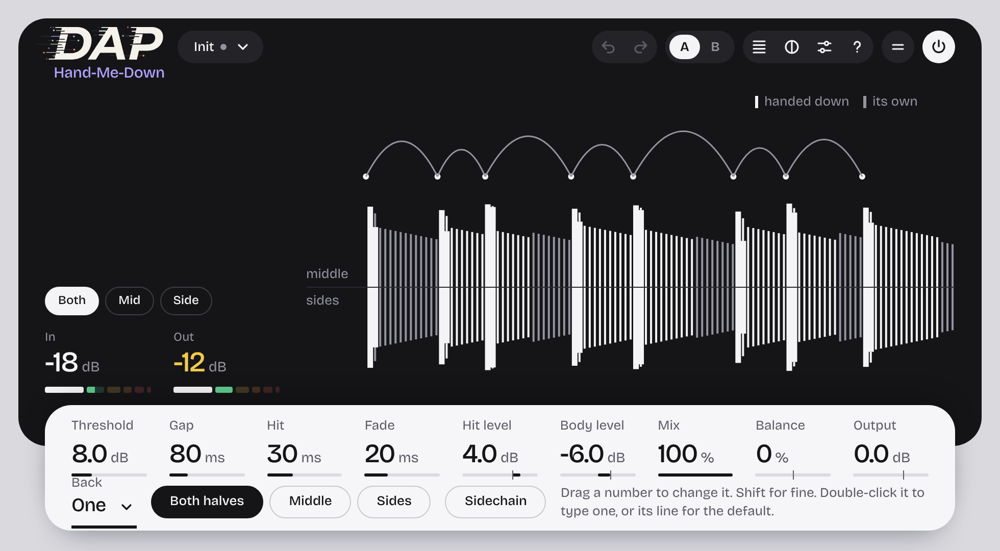
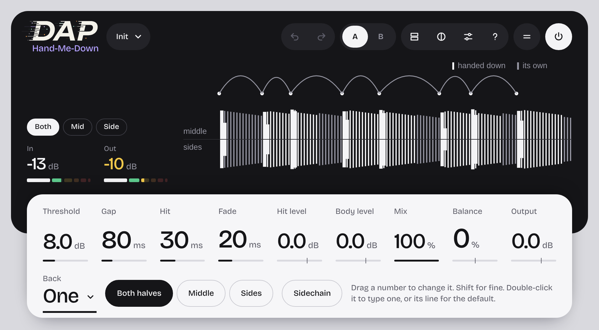
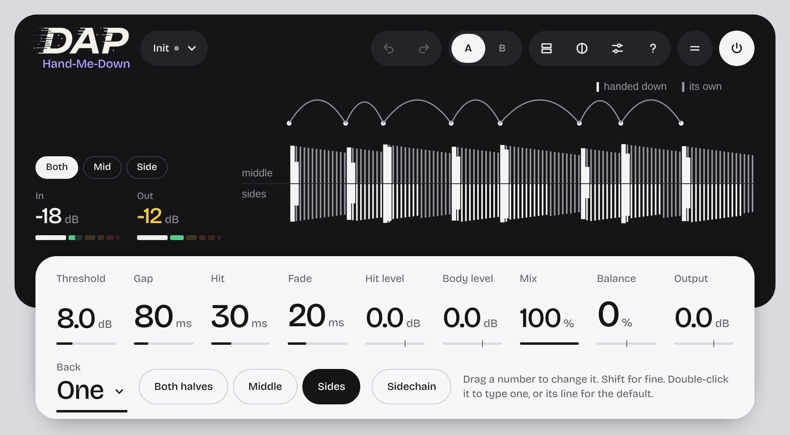

# Hand-Me-Down

Hand-Me-Down hears where each note starts. It keeps the note's own
hit, and then, in place of the note's own body, plays the body an
earlier note left behind, from the same point in that note's life.
On a melodic line every note is struck at its own pitch and rings at
the last one's: the pluck is now and the ring is one note late. On
drums each hit carries the tail of the drum before it.

When an earlier note was shorter than the one it hands down to, it
runs out: the note then gets its own body back, faded across so it
does not click. The very first note has nothing before it and keeps
its own.

## Getting started

Put Hand-Me-Down on a track that plays one note at a time with a clear
start to each: a plucked or picked line, a bass, a mallet part, a drum
loop. At its defaults each note's first 30 ms are its own and the rest
comes from the note before. Set **Hit** for how much of each note is
its own, and **Back** for how far down the line the body comes from.
If notes are missed or found where there are none, set **Threshold**
and **Gap**.

Sustained or legato parts, chords that change without a new attack,
and a full mix have few clear starts for it to find, and are changed
little.

### The picture

The dark glass shows the family line: the last few notes along time,
the newest at the right. Each note's hit is a solid slab where it
starts. Its body is a comb of thin lines after it: in ink where the
body was handed down, soft where the note has its own body because
nothing was handed to it. Over the notes, an arc runs from each note
back to the one its body came from, so Back is seen as the reach of
the arcs.

The upper half of the glass is the middle and the lower half the
sides. With **Into** at Both halves the two are the same; with Middle
or Sides only that half shows ink, and the other keeps its own soft
body.

While sound plays, the line is drawn from what the plugin has heard
over the last few seconds: a column a reading of the level going out,
and the notes where it found them. With nothing playing it draws a
line of plucks to show the shape the settings make, so a picture in
this manual is that line and not a recording.

At the left of the glass, **In** and **Out** are the levels before and
after: each number is the peak, and the segments under it break at
-24, -12, -6, -3 and 0 dB. The last segment lights if the level clips,
and stays lit until you click it.

The glass is also a control: drag it across for a longer or shorter
Hit, and up and down for Body level. Double-click it to put both back.

### Setting things

The numbers are the controls. Drag a number, or the line under it,
left and right. While you hold it, it turns purple, the ends of its
range and a mark at its default appear, and what it shapes on the
glass turns purple with it: the hits for the settings that make a
hit, the bodies for Body level.

Hold Shift for fine moves, use the mouse wheel or the arrow keys for
single steps, and double-click a line to put it back to its default.
Double-click a number to type one. **Hit level**, **Body level**,
**Balance** and **Output** rest in the middle of their ranges, so
their lines fill from their defaults, not from the left.

The foot of the sheet says what the control under the pointer does.

Right-click a number for its menu: type a value, return to the
default, copy, paste, or lock it so a preset leaves it alone. With a
number selected you can also just start typing digits, and Delete
puts it back to its default.

At the far right of the top row is **On**. Press it to hear the
sound without Hand-Me-Down: it fades across in a hundredth of a
second, so it does not click, and it is the same bypass your host's
own button works.

To put a setting on a knob of your own, right-click its number and
choose **Learn a controller**, then move the knob. The setting shows
the controller's number beside its name from then on, and your project
remembers it. **Forget** in the same menu frees it, and Escape stops
it waiting.

Beside the name is the preset that is loaded. Press it to open the
presets: point at one to hear it, press it to keep it, and **Save as
new** keeps your own, as a file under
`%APPDATA%\doesdev\Hand-Me-Down\Presets` that you can copy
to another machine. A dot beside the name means you have changed
something since. Hand-Me-Down comes with four: One note late, Two
back, slow to let go, The old ring out wide, and Drums pass it on.

At the top right, the arrows undo and redo your changes (Ctrl+Z and
Ctrl+Shift+Z), and **A B** flips between two sets of settings so you
can hear which is better: B starts as a copy of A. The stacked bars
step through three densities, Roomy, Regular and Dense, which trade
the size of the numbers for room on the glass. The split disc switches
between the dark and the light theme. The two sliders open the
settings (theme, density, how long a meter holds its peak and how
fast it falls, motion, fine drag), and the question mark turns help
on: the foot of the sheet then also says each setting's range and
where it rests. All of these are kept for every plugin of ours in the
same host.

Drag the window's corner to make the whole editor bigger or smaller.
Every setting can be automated by the host, and the host saves them
with the project. A and B and the undo history are not saved.

## The settings

### Notes

**Threshold** is how far the sound must jump over its own recent level
to count as a new note, from 2 to 24 dB. Lower finds softer notes and
more of them; higher finds only firm attacks. A note struck while the
last still rings loud jumps less, so a legato line may want it lower.

**Gap** is the shortest time between two notes, from 20 ms to 1 s. A
jump sooner than this belongs to the note already sounding: raise it
if a single note with a rough start is being split in two.

### Hit

**Hit** is how long each note keeps its own sound before the body
handed down takes over, from 1 to 250 ms. Short, and only the click or
pick of the attack is the note's own; long, and most of a short note
is.

**Fade** is how long the hit takes to hand over to the body, from 1 to
200 ms. Short is a clear seam; long lets the two notes overlap.

**Hit level** is the level of each note's own hit, from -24 to +12 dB.

### Body

**Back** is how many notes back the body comes from: One, Two, Three
or Four. One is the note just before; at Four, a pattern of four notes
rings each one's body a bar behind. A body is only handed down while
the note it came from was still sounding, so the farther back, the
more it matters that the notes are of like length.

**Into** is which half takes the body handed down: **Both halves**,
the **Middle** alone, or the **Sides** alone. With Sides, the middle
of each note is its own and only its width carries the earlier note:
a line that sits in the centre as played, with the last note's ring
out wide. A mono sound has no sides, so with Sides it passes as it
came.

**Body level** is the level of the body that follows each hit, from
-24 to +12 dB.

### Sidechain

**Sidechain**, at the foot of the sheet, lets another track say where
notes start. Route that track to Hand-Me-Down's sidechain input in
your host (it is the second input, named Sidechain), then switch it
on. A kick or a hat on another channel then decides when this track's
body is handed on, even on a sound with no attacks of its own, such as
a pad gliding from chord to chord. The sidechain itself is never
heard. With it on and nothing routed, no notes are found at all, and
the sound passes as it came.

### Mid and side

**Listen** is the three buttons on the glass above the meters.
**Both**, **Mid** and **Side** choose what you hear: everything, the
middle alone, or the sides alone. They are for listening while you
work and come in without a click. Set it back to Both before you
print, since it is a setting like any other and your host saves it.

**Balance** weighs the two halves, from -100 to 100%. Below 0% the
sides are turned down, to nothing at -100%; above, the middle is.
Neither is ever turned up.

### Output

**Mix** blends what Hand-Me-Down makes with the sound that came in,
from 0 to 100%. Since each note's hit is its own either way, Mix is in
effect how much of each body is handed down and how much is the
note's own.

**Output** sets the level after everything else, from -24 to +12 dB.

**In** and **Out** on the glass show the peak level before and after.

**Bypass** passes the sound through unchanged. It is the On button at
the top right, and your host's own bypass for the plugin: the two are
the same setting. Going in and out takes a hundredth of a second, so
it can be automated without a click.

**Match** holds the level going out to the level coming in, so that
when you change a setting you hear what it does and are not fooled by
it simply being louder. It is the button with two bars beside On. It
works on the level before Output, so Output is still yours to set on
top, and it moves slowly, over a few tenths of a second, so it never
pumps. It reaches at most 24 dB either way.

## Troubleshooting

**Nothing changes.** No notes are being found. Lower Threshold, or
check the part has clear attacks. With Sidechain on, check another
track is routed to the sidechain input. With Into at Sides, a mono
sound is left as it is.

**A note's body is its own after a moment.** The note before was
shorter than this one, so it had no more to hand down. Set Back to a
note of like length, or let it be: it is what keeps a long note from
ringing with a short one's next hit.

**Notes are split in two, or the body jumps mid-note.** A rough attack
or a tremolo is being heard as new notes. Raise Gap or Threshold.

**The first beat sounds like the track as played.** The first note
has nothing before it to inherit, and with Back at Two, Three or Four
the first notes have nothing that far back.

## Linking

Any setting can move with the same setting in other DAP instances,
whichever plugins they are. Right-click a setting and choose **Link
with other instances**: every DAP instance open is listed with a box.
Tick the ones to link; one that has no such setting is dimmed.
**All** ticks every one that can be, and **None** unlinks. From then
on, moving the setting in any of them moves it in all, in its own
units: 6 dB is 6 dB everywhere, and a value past another's range
stops at its end.

Right-click the power button to link Bypass, so several come on and
off together. A linked setting has a small link mark by its name.
Links are saved with your project. Several of one plugin are told
apart by a number, in the order they were added.
