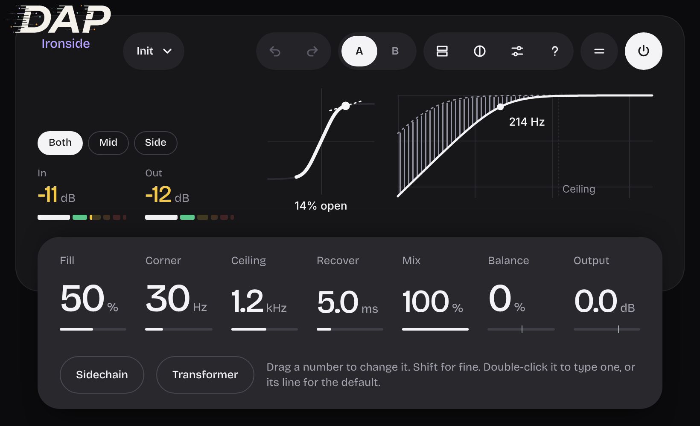

# Ironside

The sides of a stereo sound are wound on a transformer core that the
middle fills. While the core is empty the sides lose only their
deepest lows; as the middle's bass fills it, the sides' low corner
climbs, on each swing of the bass, and comes back as it lets go. A
low note fills the core far sooner than a high one, and the middle,
and any mono sound, pass untouched.

- `NOVELTY.md`: what is new about it, and what was found looking for
  it elsewhere.
- `benchmark.json`: how it stands against the best of its kind.
- `src/lib.rs`: the spec (who it is, its settings and its meters) and
  the sound.
- `ui/main.js`, `ui/core.js`, `ui/style.css`: the editor, built round
  the core and the sides' corner.
- `tests/suite.rs`: the checks every plugin is held to.
- `tests/sound.rs`: what this plugin itself promises.
- `ui/test.js`: the page's own sums, held to the sound's.
- `docs/manual.md`, `docs/scenes.json`, `docs/images/`: the manual and
  the scenes its pictures are taken from.
- `examples/demo.rs`: renders WAV demos to listen to.
- `examples/spec.rs`: the spec as JSON, for the docs tools.
