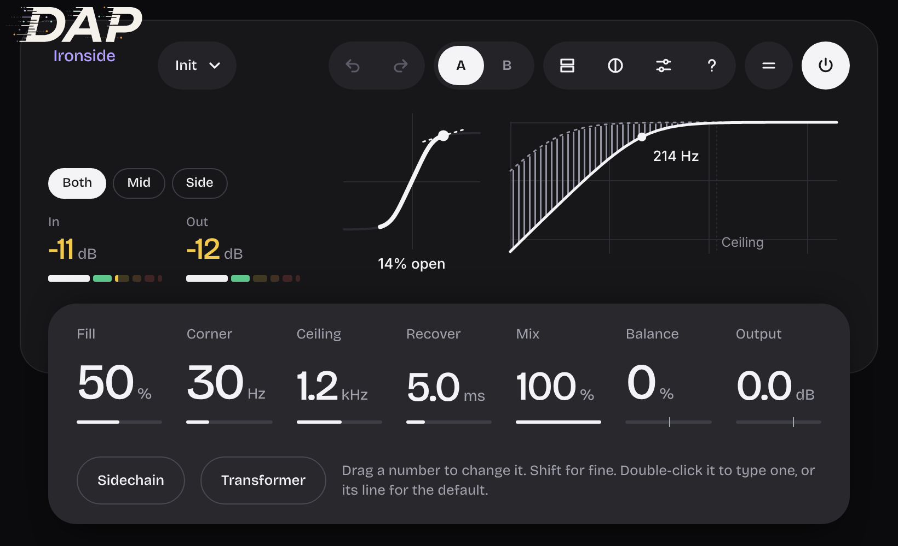
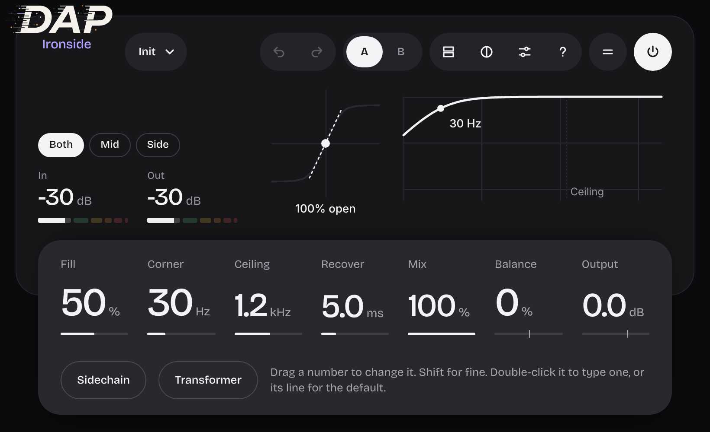
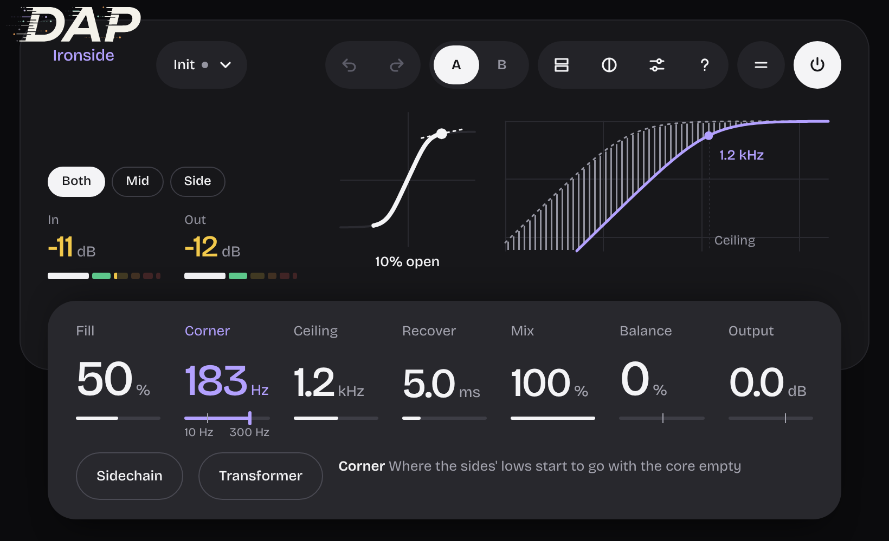
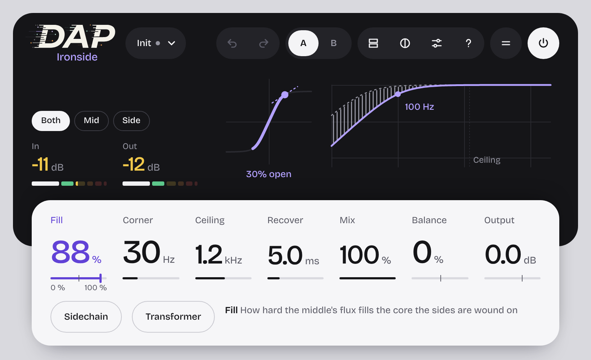
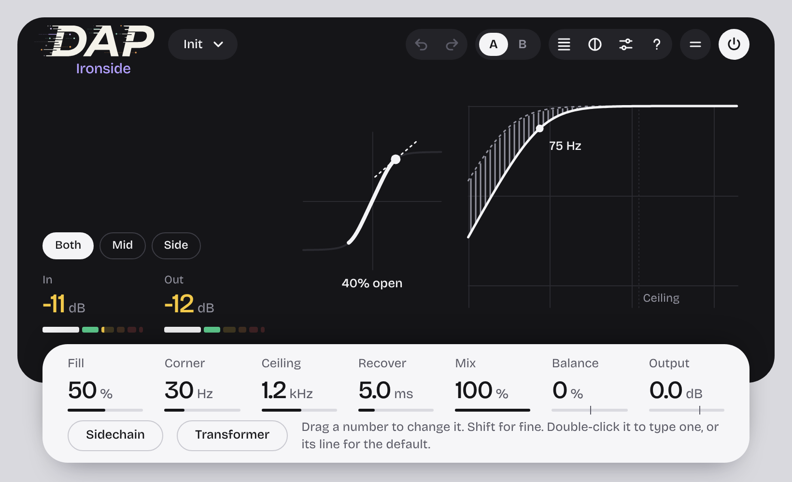
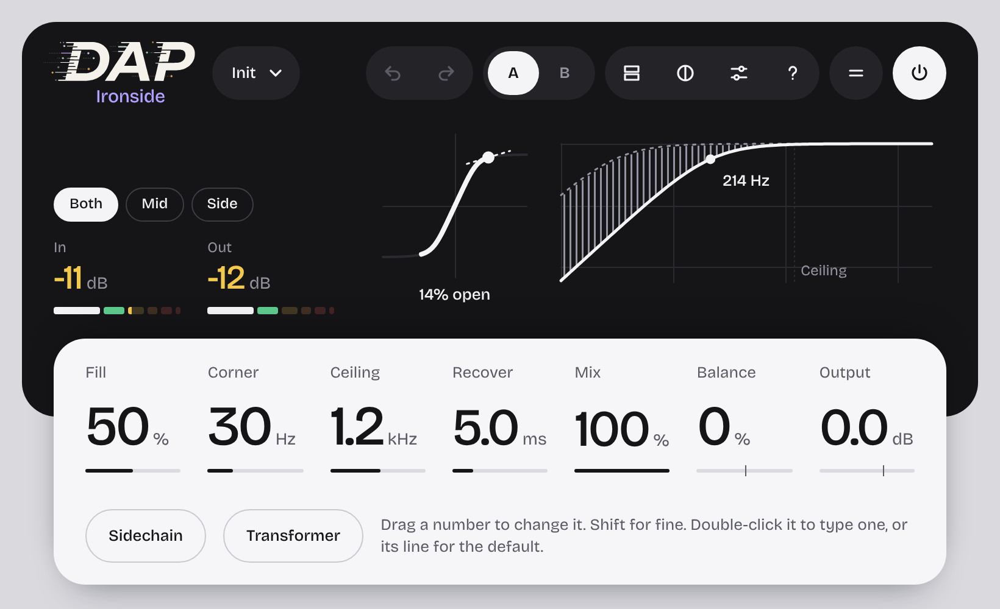
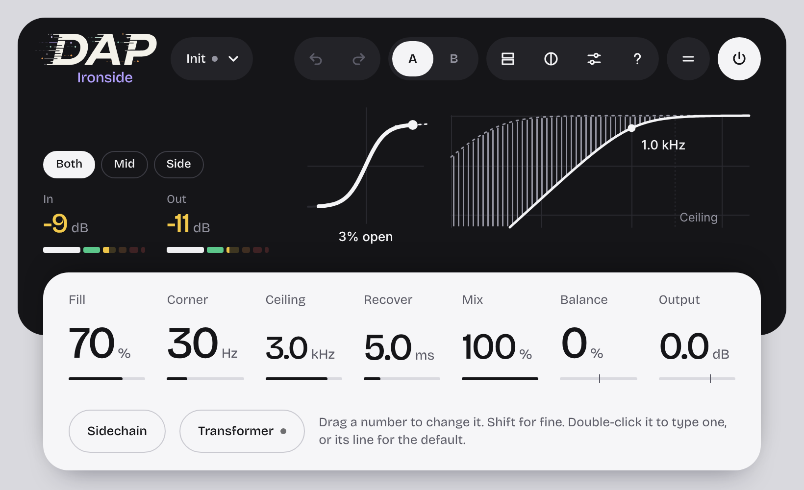
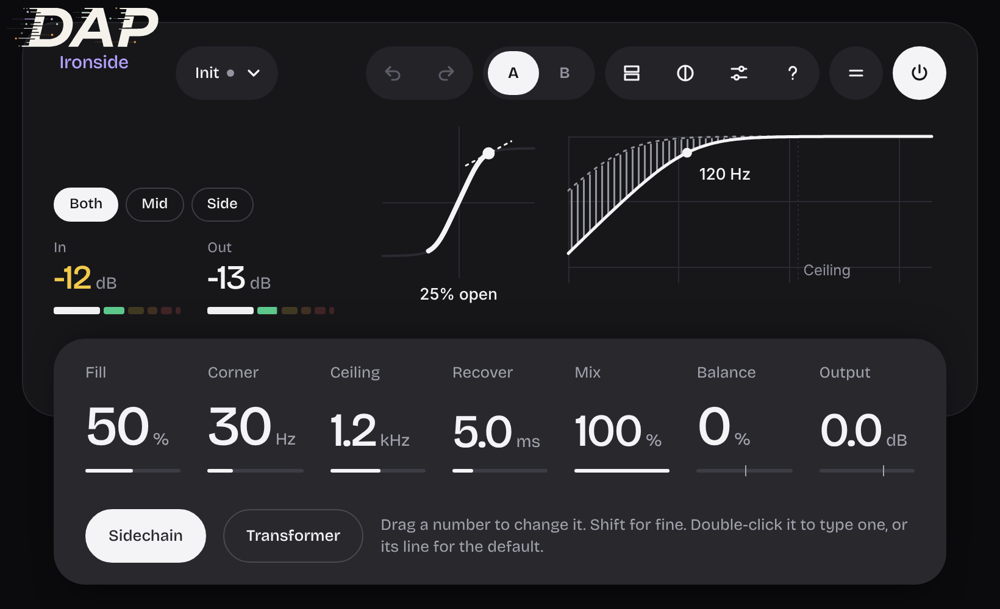
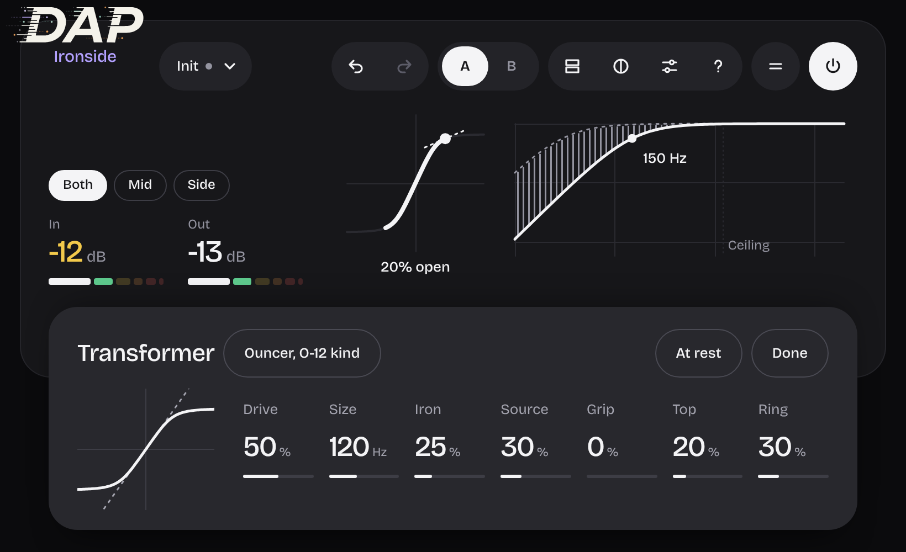
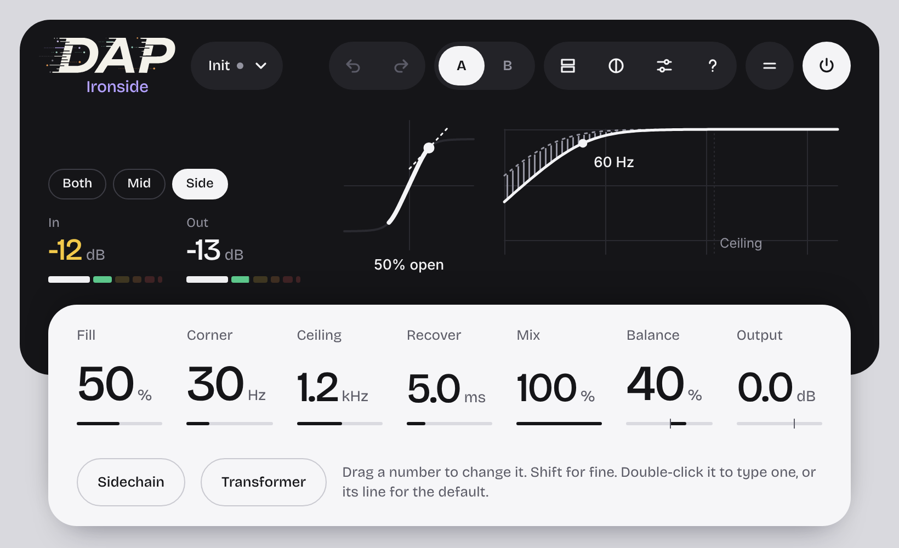

# Ironside

Ironside winds the sides of a stereo sound on a transformer core
that the middle fills. The middle goes through the core. The sides
go through a second winding on it, a choke across their path, which
holds back only their deepest lows while the core is empty. When the
middle's bass fills the core, the choke gives way and the sides'
corner climbs: their lows thin out, on each swing of the bass, and
come back as it lets go.

A core fills on flux, the sound added up over time, so a low note
fills it far sooner than a high one at the same level. A kick or a
bass line clears room in the sides. A vocal at the same level barely
touches them. The middle is never heard in the sides, and a mono
sound, which has no sides, comes out exactly as it went in.

## Getting started

Put Ironside on a stereo bus or track with weight in the middle (a
kick, a bass) and something wide with low middle in it (pads, a
stereo synth, doubled guitars, a room). At its defaults the sides
give way to the bass. Raise **Fill** until the sides make the room
you want, then set **Ceiling** for how far up their lows may go and
**Recover** for how fast they come back.

### The picture

The dark glass shows the two windings on one core.

On the left is the core's curve: steep in the middle, flat at both
ends. The solid stretch is how far up it the middle has filled the
core, either way, and the dot is where it stands. The dotted line
through the dot is the curve's slope there, which is how much the
sides' winding gets through: steep is open, flat is shut. Under it,
how open the core is, as a share.

On the right is what the sides' path does to each frequency, from
10 Hz to 20 kHz, down to 27 dB. The dashed curve is where the sides'
corner sits with the core empty, at **Corner**. The solid curve is
where the middle has pushed it now, with a dot where the sides are 3
dB down and its frequency written under it. The columns between the
two are what the middle has taken from the sides. The dotted line
with **Ceiling** beside it is as high as the corner can go. Short
ticks under the panel show where the corner has been over the last
few seconds.

At the left of the glass, **In** and **Out** are the levels before
and after: each number is the peak, and the segments under it break
at -24, -12, -6, -3 and 0 dB. The last segment lights if the level
clips, and stays lit until you click it.

The glass is also a control: drag it across for Corner and up for
Fill. Double-click it to put both back.

The picture is told how full the core is thirty times a second, so
it shows where the corner is held. The opening and shutting at each
swing of the bass is faster than that. You hear it, but the picture
does not show it.

### Setting things

The numbers are the controls. Drag a number, or the line under it,
left and right. While you hold it, it turns purple, the ends of its
range and a mark at its default appear, and what it shapes on the
glass turns purple with it.

Hold Shift for fine moves, use the mouse wheel or the arrow keys for
single steps, and double-click a line to put it back to its default.
Double-click a number to type one. **Balance** and **Output** rest in
the middle of their ranges, so their lines fill from their defaults.
The foot of the sheet says what the control under the pointer does.

Right-click a number for its menu: type a value, return to the
default, copy, paste, lock it so a preset leaves it alone, or learn a
controller for it. With a number selected you can also start typing
digits, and Delete puts it back to its default.

At the far right of the top row is **On**, the plugin's bypass. Beside
the name is the preset that is loaded. Press it to open the presets:
point at one to hear it, press it to keep it, and **Save as new**
keeps your own, as a file under
`%APPDATA%\doesdev\Ironside\Presets`. Ironside comes with four: Bass
makes room, Grain on every swing, Slow steel and Gentle thinning.

At the top right, the arrows undo and redo (Ctrl+Z and Ctrl+Shift+Z),
and **A B** flips between two sets of settings. The stacked bars step
through three densities, the split disc switches theme, the two
sliders open the settings, and the question mark turns help on.

Drag the window's corner to make the whole editor bigger or smaller.
Every setting can be automated by the host, and the host saves them
with the project. A and B and the undo history are not saved.

## The settings

### Core

**Fill** is how hard the middle's flux fills the core the sides are
wound on, from 0 to 100%. At 0% the sides feel nothing and Ironside
leaves them as they are. At 50%, where it rests, a bass at -12 dB at
the core's size all but shuts the core. At 100% a quiet bass does.

**Recover** is how long the core takes to let the sides back after
the middle fills it, from 0 to 500 ms. It closes at once whatever
this is. At 0 the sides open and shut twice in every wave of the
bass, at its crests either way up, which is heard as a grain in the
stereo image. Longer, and the sides stay thinned through the note
and come back smoothly after it, more like a duck.

### Sides

**Corner** is where the sides' lows start to go with the core empty,
from 10 to 300 Hz. Below it they fall away at 6 dB an octave. With
nothing in the middle this is all Ironside does to the sides.

**Ceiling** is the highest the middle can push the sides' corner,
from 0.2 to 5 kHz. The corner climbs as the core shuts: half as open,
twice as high. It never goes past Ceiling, so the sides' upper range
is always kept. Low, and only the sides' lows give way. High, and a
full core thins the sides up into their middle.

### Sidechain

**Sidechain**, at the foot of the sheet, hands the filling to another
track. Route that track to Ironside's sidechain input in your host
(the second input, named Sidechain), then switch it on. The middle of
that track now fills the core, and nothing of this track's own does:
a kick on another channel can clear room in a pad's sides. The
sidechain itself is never heard. With it on and nothing routed,
nothing fills the core and the sides pass at Corner.

### The transformer window

**Transformer**, at the foot of the sheet, opens a window on the core
itself. In Ironside it is the core both windings are on, so it shapes
two things: what the middle hears of the core, and how the core fills
for the sides. Everything in it rests where the middle passes
untouched. A dot on the button means something in there has been
moved, **At rest** puts it all back, and **Done** closes the window.
Every plugin of ours with a transformer has this same window.

**Character** sets the whole window in one step, after a kind of
transformer: a T14 microphone output, an O-12 ouncer, a gapped LO1166
output, a clean nickel input or a big steel output. They are places
to start from, not copies of a part.

**Drive** is how hard the middle is pushed into the core for its own
sound, from 0 to 100%: the lows thicken and then fold. It is the
middle's colour only. How hard the core fills for the sides is Fill.

**Size** is how much iron there is: the note at which a full level
fills the core, from 20 Hz to 1 kHz. It is the same core for both
windings, so it also says which notes in the middle thin the sides.
At 60 Hz, where it rests, the kick and the bass do. Raised, the low
mids join in.

**Iron** is what the core is made of, from nickel at 0% to steel at
100%. Nickel holds straight until a sudden knee. Steel bends sooner
and more gently, so it starts to thin the sides on a quieter bass,
and it lags behind the sound.

**Source** is how much what feeds the core resists, from 0 to 100%:
more of the core's bend is heard on the middle, and less of its bass
until it is loud.

**Grip** is a standing current in a gapped core, from 0 to 100%: the
core leans one way, which adds even harmonics to the middle and gives
up some of its bass. It also leans the core the sides read, so one
half of a wave shuts it sooner than the other.

**Top** brings the windings' resonance down into hearing, from 0 to
100%, and **Ring** is how little the load damps it, from 0 to 100%:
a smooth roll at the top of the middle, or a peak with an edge.

### Mid and side

**Listen** is the three buttons on the glass above the meters. **Both**,
**Mid** and **Side** choose what you hear: everything, the middle
alone, or the sides alone. Set it back to Both before you print.

**Balance** weighs the two halves, from -100 to 100%. Below 0% the
sides are turned down, to nothing at -100%; above, the middle is.

### Output

**Mix** blends what Ironside makes with the sound that came in, from
0 to 100%. It mixes both halves: the middle as the core left it and
the sides as the choke left them.

**Output** sets the level after everything else, from -24 to +12 dB.

**Bypass** passes the sound through unchanged. It is the On button at
the top right and your host's own bypass for the plugin.

**Match** holds the level going out to the level coming in, so you
hear what a setting does to the tone and are not fooled by its being
quieter. Thinning the sides takes level away, and Match puts it back
over the whole sound. It works before Output, and moves over a few
tenths of a second, so it never pumps.

### Quality

The choke's corner moves very fast, and the core bends the middle.
Both make a little above the top of hearing that would fold back
down as tones that were never played. Ironside runs both at a higher
rate inside where there is room for it. Two settings say how, in
Settings (the button with two sliders), under the line that says
they are Ironside's own.

**Oversampling** is the rate while you play: **Auto**, **Off**, or 2,
4, 8 or 16 times. Leave it at Auto. It spends only what would be
heard: the middle's rate follows how far up the core it is driven,
and the sides' rate follows how hard the core has shut.

**When rendering** is what an export to a file gets. **Best** is 16
times with finer filters. **As playing** uses the Oversampling
setting, and the rest are a rate by hand.

**Keep as default** makes the two, as they stand, where every new
Ironside starts, and sets every Ironside open in the project to
match: **For Ironside**. **For every DAP plugin** does the same for
all of ours that have these settings.

Ironside comes out a little late for this: 39 samples while playing
and 65 when rendering. It tells your host, which lines the other
tracks up with it.

## Troubleshooting

**Nothing changes.** Ironside only thins the sides, so a mono track,
or one with nothing wide in its low end, passes as it is. Check that
something in the middle is low and loud enough to fill the core:
raise Fill, or lower Size in the transformer window to let the low
mids fill it too.

**The sides got thin all the time.** Corner is high, or Recover is
long against a busy bass. Bring either down.

**It sounds gritty.** That is Recover near 0: the sides open and
shut at every swing of the bass. Raise Recover to smooth it.

## Linking

Any setting can move with the same setting in other DAP instances,
whichever plugins they are. Right-click a setting and choose **Link
with other instances**, and tick the ones to link. The transformer
window's settings link with the same settings in any other DAP
plugin with a transformer.
