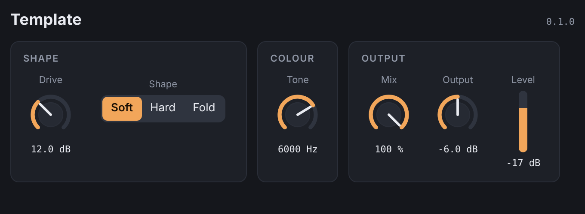

# Template

Drive, tone and mix. Not shipped: it is the plugin `npm run new`
copies, and the proof that the kit works end to end.

- `src/lib.rs`: the spec (who it is, its settings and its meter) and
  the sound.
- `ui/main.js`, `ui/style.css`: the editor, composed from the kit's
  controls.
- `tests/suite.rs`: the checks every plugin is held to.
- `tests/sound.rs`: what this plugin itself promises.
- `docs/manual.md`, `docs/scenes.json`, `docs/images/`: the manual and
  the scenes its pictures are taken from.
- `examples/demo.rs`: renders WAV demos to listen to.
- `examples/spec.rs`: the spec as JSON, for the docs tools.

A plugin that ships also has a `NOVELTY.md`: what is new about it and
what turned up when looking for it elsewhere.
