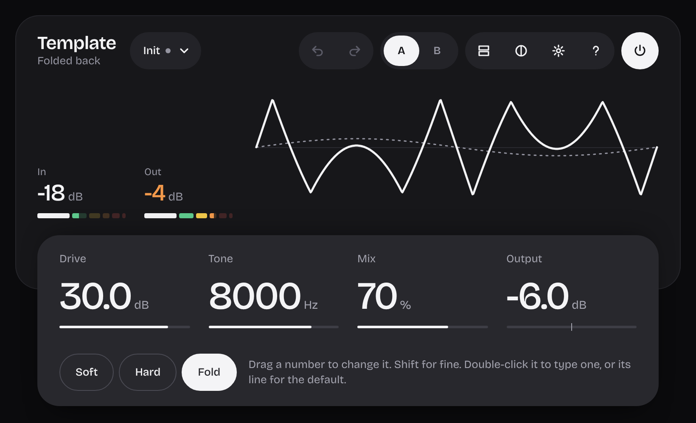
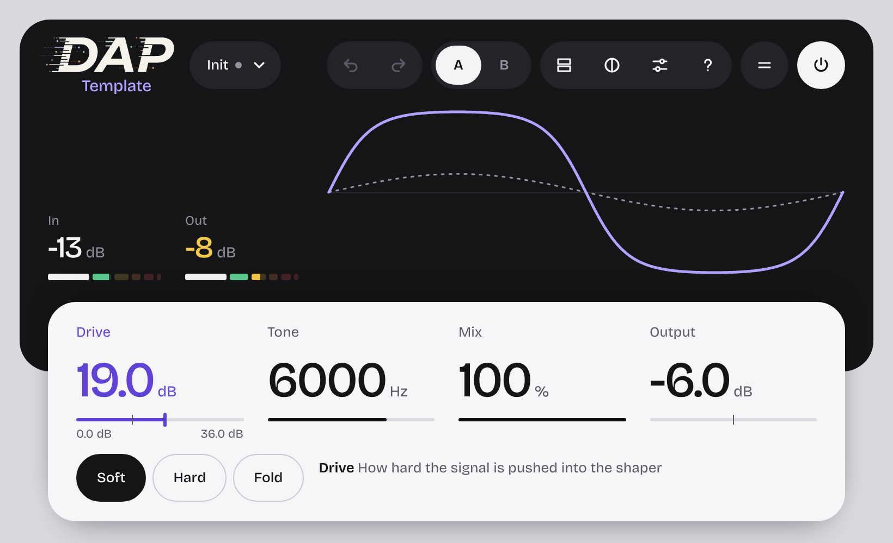
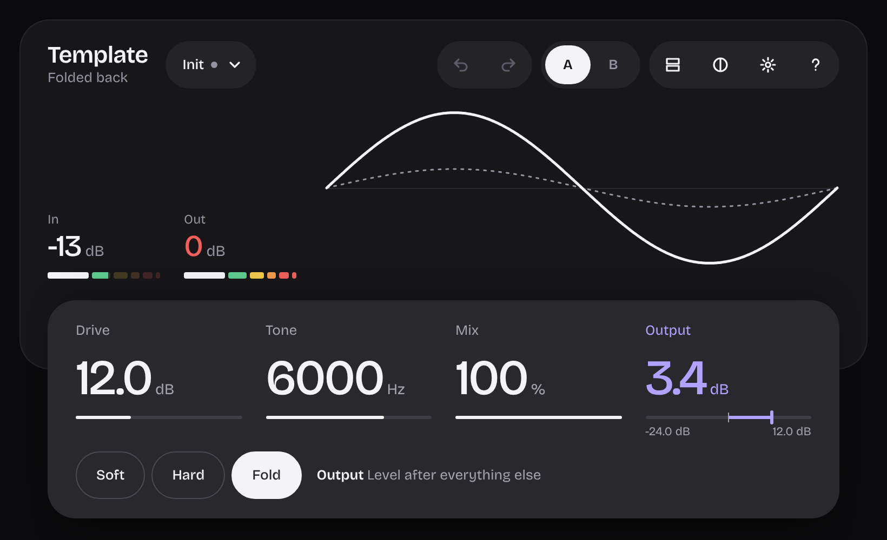
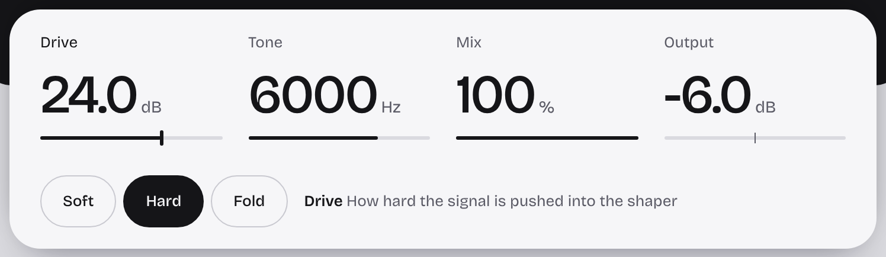
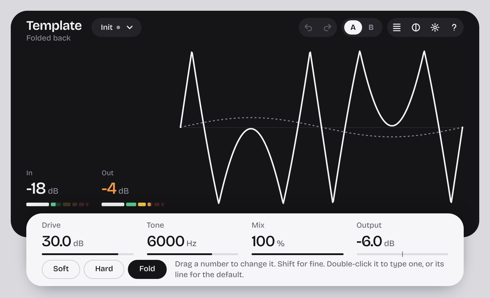
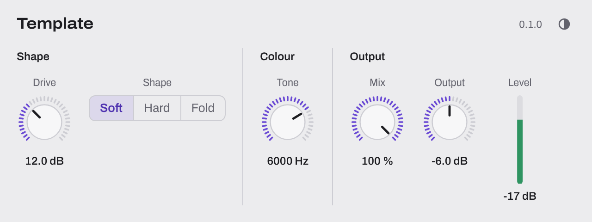

# Template

Template pushes a signal into a shaper, takes the top off what comes
out, and mixes it back against the dry signal. It is the plugin every
new one in this repo starts as, so it is small on purpose: three
stages, five settings, a bypass, level matching and two meters.

## Getting started

Put Template on a track as an insert. At its defaults it adds a gentle
soft drive and trims the level by 6 dB. Slide **Drive** up until you
hear the edge you want, pick a **Shape**, then bring **Output** down
to match the level you started with.

### The picture

The dark glass shows what Template is doing to the sound: dashed
going in, solid coming out. While sound is running it is the sound
itself, held still so you can read its shape; with nothing playing it
is one cycle of a wave, to show the bend by. Under
the name it says which bend is on. At the foot of the glass, **In**
and **Out** are the levels before and after: each number is the peak,
and the segments under it break at -24, -12, -6, -3 and 0 dB. The last
segment lights if the level clips, and stays lit until you click it.
Behind the wave, faint columns show the level that went out over the
last four seconds, the newest at the right.

The wave is also a control: drag it up to drive harder and down to
ease off, and double-click it to put Drive back.

### Setting things

The numbers are the controls. Drag a number, or the line under it,
left and right. While you hold it, it turns purple, the ends of its
range and a mark at its default appear, and the wave on the glass
turns purple with it if it is one that shapes the wave.

Hold Shift for fine moves, use the mouse wheel or the arrow keys for
single steps, and double-click a line to put it back to its default.
Double-click a number to type one: `8k` and `8000 Hz` both work for
Tone. **Output** rests in the middle of its range, so its line fills
from its default, not from the left.

The foot of the sheet says what the control under the pointer does.

Right-click a number for its menu: type a value, return to the
default, copy, paste, or lock it so a preset leaves it alone. With a
number selected you can also just start typing digits, and Delete
puts it back to its default.

At the far right of the top row is **On**. Press it to hear the
sound without Template: it fades across in a hundredth of a second,
so it does not click, and it is the same bypass your host's own
button works.

To put a setting on a knob of your own, right-click its number and
choose **Learn a controller**, then move the knob. The setting shows
the controller's number beside its name from then on, and your project
remembers it. **Forget** in the same menu frees it, and Escape stops
it waiting.

Beside the name is the preset that is loaded. Press it to open the
presets: point at one to hear it, press it to keep it, and **Save as
new** keeps your own, as a file under
`%APPDATA%\doesdev\Template\Presets` that you can copy to another
machine. A dot beside the name means you have changed
something since.

At the top right, the arrows undo and redo your changes (Ctrl+Z and
Ctrl+Shift+Z), and **A B** flips between two sets of settings so you
can hear which is better: B starts as a copy of A. The stacked bars
step through three densities, Roomy, Regular and Dense, which trade
the size of the numbers for room on the glass. The split disc switches
between the dark and the light theme. The sun opens the settings
(theme, density, how long a meter holds its peak, motion, fine drag),
and the question mark turns help on: the foot of the sheet then also
says each setting's range and where it rests. All of these are kept
for every plugin of ours in the same host.

Drag the window's corner to make the whole editor bigger or smaller.
Every setting can be automated by the host, and the host saves them
with the project. A and B and the undo history are not saved.

## The settings

### Shape

**Drive** is how hard the signal is pushed into the shaper, from 0 to
36 dB. More drive means more of the signal goes past the shaper's
limit, so the sound gets denser and brighter.

**Shape** picks what happens to the part of the signal that goes past
the limit:

| Shape | What it does | How it sounds |
|-------|--------------|---------------|
| Soft  | Bends smoothly toward the limit | Warm, like tape |
| Hard  | Stops flat at the limit | Bright and buzzy |
| Fold  | Turns back from the limit | Hollow and metallic |

### Colour

**Tone** is a low-pass filter after the shaper, from 200 Hz to 16 kHz.
Shaping adds high harmonics; Tone decides how many of them you keep.

### Output

**Mix** blends the shaped signal with the dry one. At 100% you hear
only the shaped signal, at 0% only the dry.

**Output** sets the level after everything else, from -24 to +12 dB.
Driving a signal makes it louder, so expect to turn this down as Drive
goes up.

**In** and **Out** on the glass show the peak level before and after.
If the level going out reaches full scale, the last segment lights
and stays lit until you click it: bring Output down.

**Bypass** passes the sound through unchanged. It is the On button at
the top right, and your host's own bypass for the plugin: the two are
the same setting. Going in and out takes a hundredth of a second, so
it can be automated without a click.

**Match** holds the level going out to the level coming in, so that
when you change a setting you hear what it does to the tone and are
not fooled by it simply being louder. It is the button with two bars
beside On. It works on the level before Output, so Output is still
yours to set on top, and it moves slowly, over a few tenths of a
second, so it never pumps. It reaches at most 24 dB either way.

## Troubleshooting

**The sound is the same whatever I turn.** Check Mix: at 0% only the
dry signal is heard.

**It got much louder.** That is Drive doing its job. Match the level
with Output.

**It sounds dull.** Turn Tone up; at its lowest it leaves little above
200 Hz.

## Linking

Any setting can move with the same setting in other DAP instances,
whichever plugins they are. Right-click a setting and choose **Link
with other instances**: every DAP instance open is listed with a box.
Tick the ones to link; one that has no such setting is dimmed.
**All** ticks every one that can be, and **None** unlinks. From then
on, moving the setting in any of them moves it in all, in its own
units: 6 dB is 6 dB everywhere, and a value past another's range
stops at its end.

Right-click the power button to link Bypass, so several come on and
off together. A linked setting has a small link mark by its name.
Links are saved with your project. Several of one plugin are told
apart by a number, in the order they were added.
