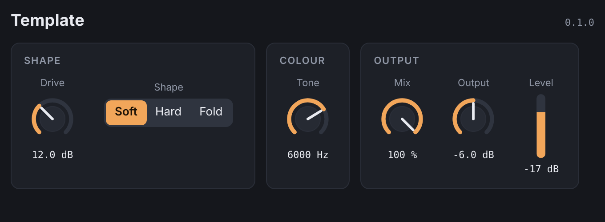
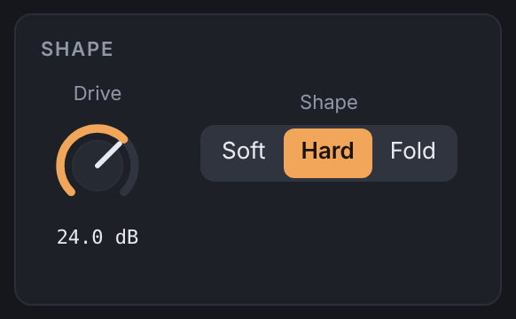

# Template

Template pushes a signal into a shaper, takes the top off what comes
out, and mixes it back against the dry signal. It is the plugin every
new one in this repo starts as, so it is small on purpose: three
stages, five settings and one meter.

## Getting started

Put Template on a track as an insert. At its defaults it adds a gentle
soft drive and trims the level by 6 dB. Turn **Drive** up until you hear the edge you
want, pick a **Shape**, then bring **Output** down to match the level
you started with.

Drag a knob up or down to turn it. Hold Shift for fine moves, use the
mouse wheel or the arrow keys for single steps, and double-click to put
a setting back to its default. Every setting can be automated by the
host, and the host saves them with the project.

## The settings

### Shape

**Drive** is how hard the signal is pushed into the shaper, from 0 to
36 dB. More drive means more of the signal goes past the shaper's
limit, so the sound gets denser and brighter.

**Shape** picks what happens to the part of the signal that goes past
the limit:

| Shape | What it does | How it sounds |
|-------|--------------|---------------|
| Soft  | Bends smoothly toward the limit | Warm, like tape |
| Hard  | Stops flat at the limit | Bright and buzzy |
| Fold  | Turns back from the limit | Hollow and metallic |

### Colour

**Tone** is a low-pass filter after the shaper, from 200 Hz to 16 kHz.
Shaping adds high harmonics; Tone decides how many of them you keep.

### Output

**Mix** blends the shaped signal with the dry one. At 100% you hear
only the shaped signal, at 0% only the dry.

**Output** sets the level after everything else, from -24 to +12 dB.
Driving a signal makes it louder, so expect to turn this down as Drive
goes up.

The **Level** meter beside it shows the peak level going out. If it
sits at the top, bring Output down.

## Troubleshooting

**The sound is the same whatever I turn.** Check Mix: at 0% only the
dry signal is heard.

**It got much louder.** That is Drive doing its job. Match the level
with Output.

**It sounds dull.** Turn Tone up; at its lowest it leaves little above
200 Hz.
