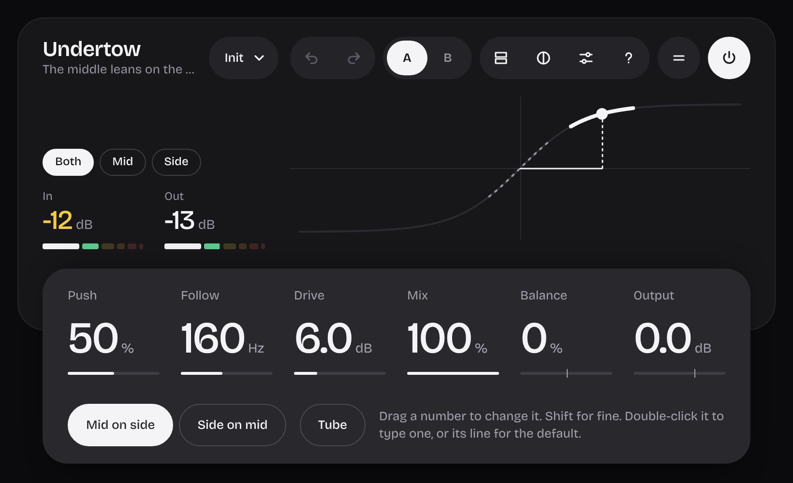
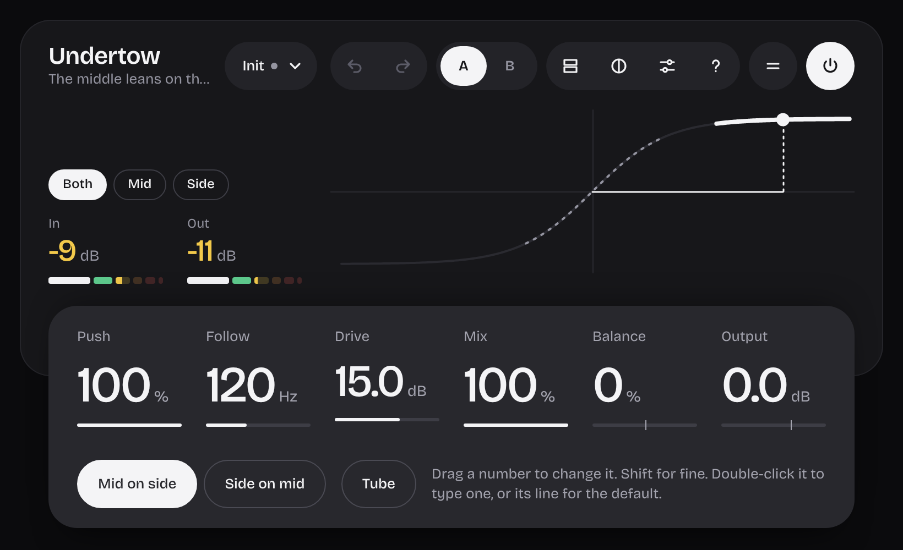
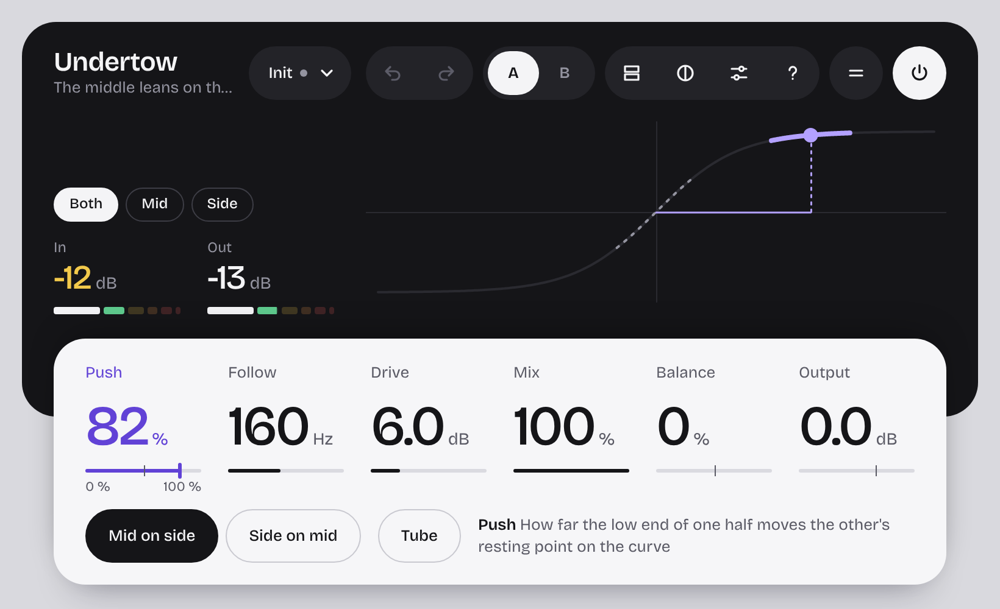
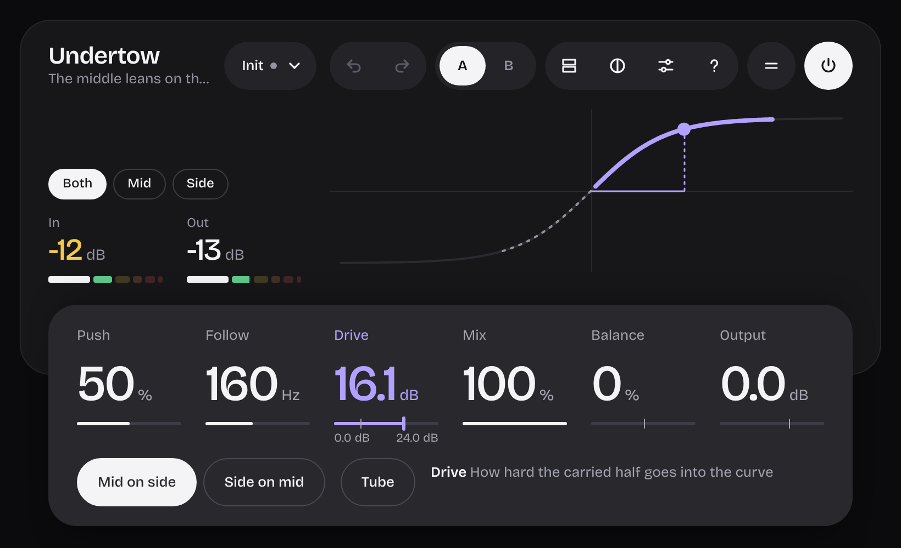
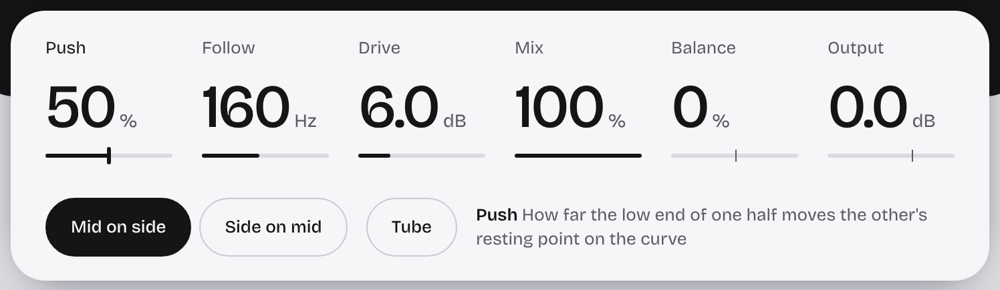
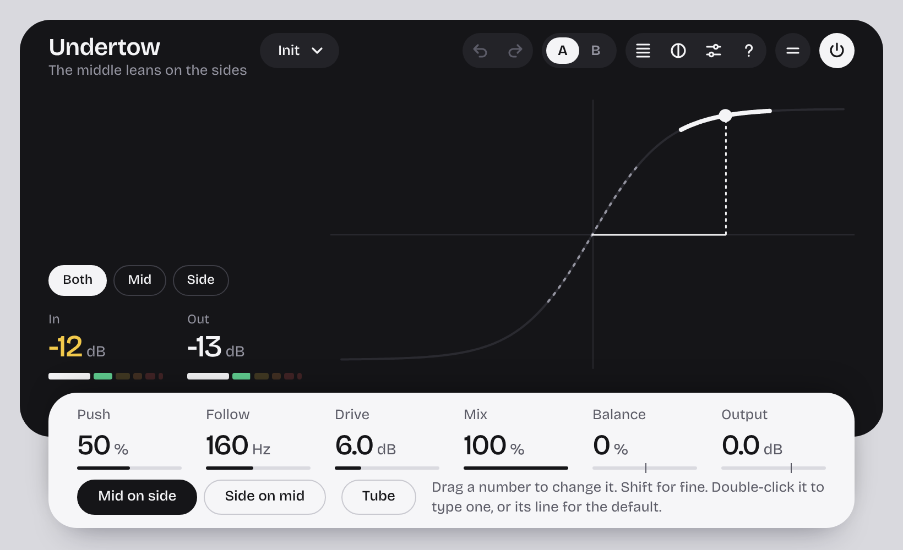
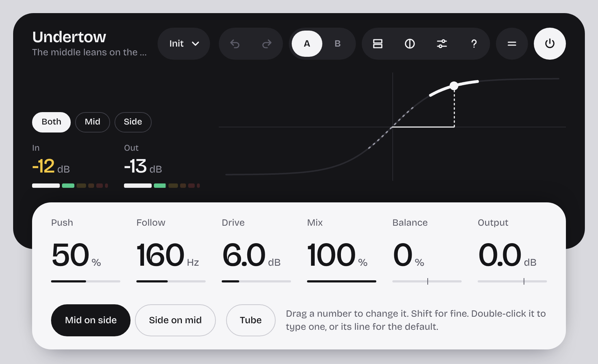
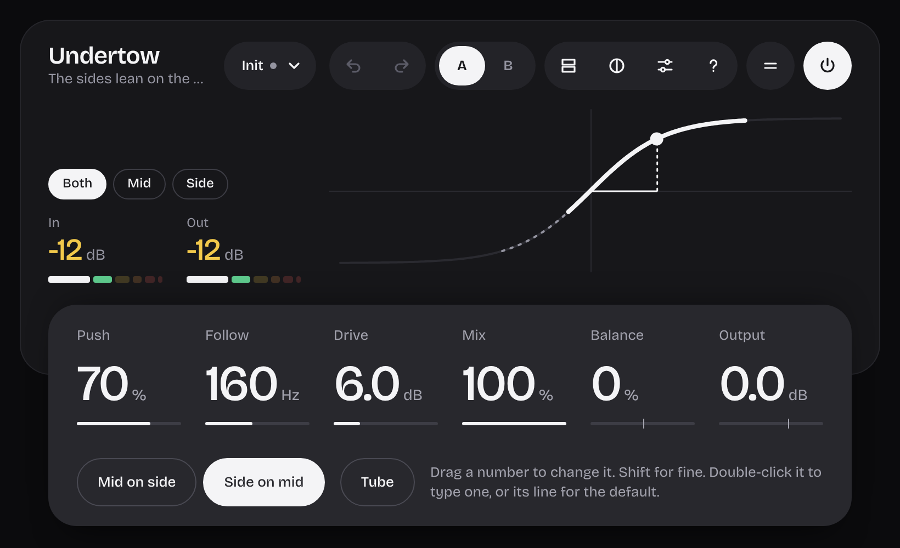
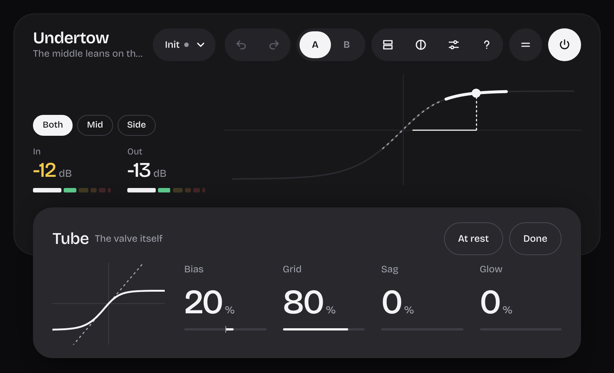
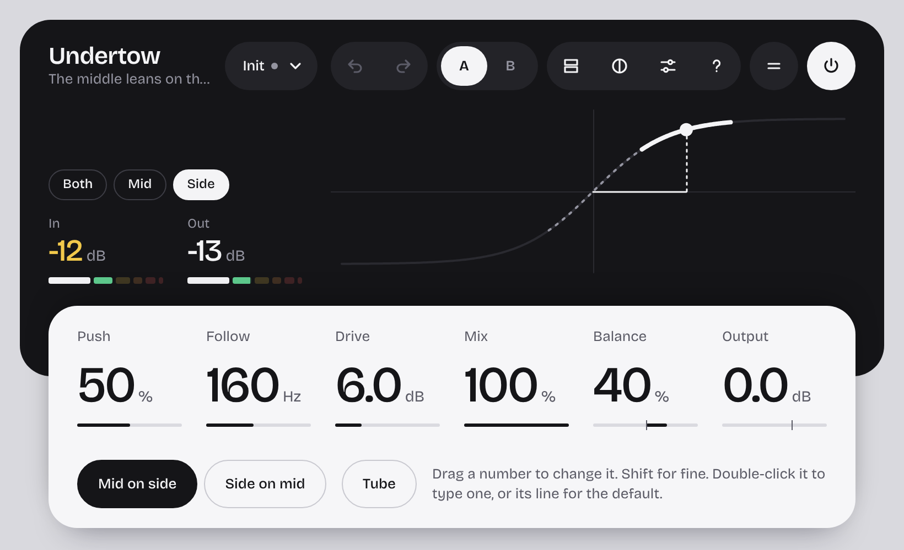

# Undertow

Undertow is a saturator for the sides of a stereo sound, steered by
the middle. The sides go through a valve-like curve, and the low end
of the middle decides, sample by sample, where on that curve they
sit. When the bass swings up it pushes the sides up the curve, and
when it swings down it pushes them down. Off its centre the curve is
lopsided and flatter, so the sides take on a sheen of even harmonics
and give a little ground in time with the bass itself.

The middle is never changed and never heard in the sides. A mono
sound, which has no sides, comes out exactly as it went in.

## Getting started

Put Undertow on a stereo bus or track that has something in the
middle with weight (a kick, a bass, a vocal with body) and something
wide around it (a room, doubles, pads, a stereo reverb). At its
defaults the sides lean gently on the middle's low end. Raise
**Push** until the sides move with the bass in the way you want,
then set **Drive** for how much colour the sides take on their own.

### The picture

The dark glass shows the valve's curve: flat at both ends, steep in
the middle. The faint line is the whole curve. The dashed stretch at
its centre is where the sides would swing if nothing pushed them. The
solid stretch, with a dot at its centre, is where they are swinging
now: the line along the axis from the centre to under the dot is how
far the middle's bass has pushed them, and the dotted line goes up
from there to the curve. While sound plays, the dot rides along the
curve with the bass, and short ticks show where it has been.

The farther the dot is from the centre, the more lopsided the bit of
curve the sides are on, and the more even harmonics they get. Where
the curve is flat, the sides are held back a little.

At the foot of the glass, **In** and **Out** are the levels before and
after: each number is the peak, and the segments under it break at
-24, -12, -6, -3 and 0 dB. The last segment lights if the level clips,
and stays lit until you click it.

The glass is also a control: drag it up for more Push and down for
less, and across for more or less Drive. Double-click it to put both
back.

### Setting things

The numbers are the controls. Drag a number, or the line under it,
left and right. While you hold it, it turns purple, the ends of its
range and a mark at its default appear, and the riding stretch on the
glass turns purple with it.

Hold Shift for fine moves, use the mouse wheel or the arrow keys for
single steps, and double-click a line to put it back to its default.
Double-click a number to type one: `1k` and `1000 Hz` both work for
Follow. **Output** rests in the middle of its range, so its line
fills from its default, not from the left.

The foot of the sheet says what the control under the pointer does.

Right-click a number for its menu: type a value, return to the
default, copy, paste, or lock it so a preset leaves it alone. With a
number selected you can also just start typing digits, and Delete
puts it back to its default.

At the far right of the top row is **On**. Press it to hear the
sound without Undertow: it fades across in a hundredth of a second,
so it does not click, and it is the same bypass your host's own
button works.

To put a setting on a knob of your own, right-click its number and
choose **Learn a controller**, then move the knob. The setting shows
the controller's number beside its name from then on, and your project
remembers it. **Forget** in the same menu frees it, and Escape stops
it waiting.

Beside the name is the preset that is loaded. Press it to open the
presets: point at one to hear it, press it to keep it, and **Save as
new** keeps your own, as a file under
`%APPDATA%\doesdev\Undertow\Presets` that you can copy to another
machine. A dot beside the name means you have changed something
since. Undertow comes with four: Room on the kick, Sheen on the
doubles, Gentle undertow and Sides on the middle.

At the top right, the arrows undo and redo your changes (Ctrl+Z and
Ctrl+Shift+Z), and **A B** flips between two sets of settings so you
can hear which is better: B starts as a copy of A. The stacked bars
step through three densities, Roomy, Regular and Dense, which trade
the size of the numbers for room on the glass. The split disc switches
between the dark and the light theme. The two sliders open the
settings (theme, density, how long a meter holds its peak and how
fast it falls, motion, fine drag),
and the question mark turns help on: the foot of the sheet then also
says each setting's range and where it rests. All of these are kept
for every plugin of ours in the same host.

Drag the window's corner to make the whole editor bigger or smaller.
Every setting can be automated by the host, and the host saves them
with the project. A and B and the undo history are not saved.

## The settings

### Lean

**Push** is how far the low end of the leaning half moves the other
half's resting point on the curve, from 0 to 100%. At 0% the sides
sit at the centre of the curve whatever the bass does, and Undertow
is a plain saturator on the sides. At 100% a full-scale bass can push
them out to the flat of the curve.

**Follow** is how much of the leaning half does the pushing: only
what is below this frequency, from 30 Hz to 1 kHz. Low, and only the
deepest bass moves the sides, slowly. Higher, and the kick's click
and the low mids push too, so the sides move faster and rougher.

**Steer** says which half leans on which. **Mid on side**, the
default, is the middle's bass pushing the sides. **Side on mid** turns
it round: the low end of the sides pushes the middle, and the sides
pass untouched. That is for when the sides carry the weight, such as
a wide synth bass under a mono vocal.

### Valve

**Drive** is how hard the carried half goes into the curve, from 0 to
24 dB. The swing drawn on the glass gets wider with it. A small sound
comes out at its own level; louder ones are rounded off by the curve.

### The tube window

**Tube**, at the foot of the sheet, opens a window on the valve
itself. It has four settings and draws the curve they make; the
dashed line is a sound left alone. All four rest where Undertow has
always sounded, so nothing changes until you move one. A dot on the
Tube button means something in there has been moved, **At rest** puts
all four back, and **Done** closes the window. Every plugin of ours
with a valve in it has this same window.

**Bias** is where on its curve the valve rests before the bass pushes
it, from -100 to 100%. Off 0% the carried half is already on a
lopsided part of the curve, so it has even harmonics even with Push
at 0%. The curve on the glass moves its resting point with it.

**Grid** is how suddenly the top half of the curve gives out, from 0
to 100%. At 0% both halves round off alike. Higher, and the upward
swing flattens sooner and lower than the downward one, which is
harder and brighter. The curve on the glass changes with it.

**Sag** is how far a held loud sound eases back, from 0 to 100%, as a
valve's supply droops under load. Quiet sounds are left alone; loud,
sustained ones lose a little and soften.

**Glow** is how high the harmonics the valve adds sit, from 0 to
100%. The sound going in is not made brighter: only what the curve
adds is.

### Mid and side

**Listen** is the three buttons on the glass above the meters.
**Both**, **Mid** and **Side** choose what you hear: everything, the middle alone, or the sides alone. They
are for listening while you work and come in without a click. Set it
back to Both before you print, since it is a setting like any other
and your host saves it.

**Balance** weighs the two halves, from -100 to 100%. Below 0% the
sides are turned down, to nothing at -100%; above, the middle is.
Neither is ever turned up, so with Output it sets the level of each.

### Output

**Mix** blends the leaned half with its own dry signal, from 0 to
100%. The other half is never touched, so Mix only ever changes the
carried one.

**Output** sets the level after everything else, from -24 to +12 dB.

**In** and **Out** on the glass show the peak level before and after.

**Bypass** passes the sound through unchanged. It is the On button at
the top right, and your host's own bypass for the plugin: the two are
the same setting. Going in and out takes a hundredth of a second, so
it can be automated without a click.

**Match** holds the level going out to the level coming in, so that
when you change a setting you hear what it does to the tone and are
not fooled by it simply being louder. It is the button with two bars
beside On. It works on the level before Output, so Output is still
yours to set on top, and it moves slowly, over a few tenths of a
second, so it never pumps. It reaches at most 24 dB either way.

## Troubleshooting

**Nothing changes.** Undertow only works on a stereo sound: a mono
track, or one with nothing in the sides, passes through as it is.
Check Mix too: at 0% the dry sound is heard.

**The sides got quieter.** That is the curve flattening where the bass
has pushed them. Ease Push or Drive, or lower Follow so less of the
middle pushes.

**It sounds gritty.** Follow is high enough that fast sounds in the
middle are moving the sides. Bring it down toward the bass.
